# Handwritten Deep Learning Networks: A Progress Report

**Period**: October 11 – 28, 2026  
**Code**: <https://github.com/MIng-Diamond/DLLearning>

## Preface

This report covers what I did between October 11 and 28. The task came from my senior: hand-write the networks that come up most often in deep learning, as preparation for joining an embodied AI group.

The rule I followed: I write the model structures and training loops myself. Data loading, optimizers, and autograd use PyTorch's built-in APIs. So you will not see "I fine-tuned someone else's model" in here, but I also will not pretend everything was written from scratch. I will point out which parts are mine and which are library calls.

All code is in the repository. Each directory has runnable scripts and self-checks. Every figure in this report was produced by running the code. One note on the figures: they are the original experiment outputs, so some axis labels are in Chinese.

## 1. What I Completed

| Stage | What I did | Result |
|---|---|---|
| 0 | NumPy basics, softmax, linear regression, gradient check | Closed-book test 5/5 |
| 1 | NumPy backprop for an MLP; PyTorch MLP | sin fit loss 3.08 → 0.0031; Fashion-MNIST 86.88% |
| Project Zero | California Housing linear regression | R² = 0.6374, RMSE = 0.70 |
| 2 | conv2d / maxpool from scratch; PyTorch CNN | 90.24% → 92.25% |
| 3 | RNN / GRU / LSTM; attention from scratch; Transformer | Sequence reversal 100%; Mini-GPT val loss 1.64 |

By October 28, stages 0 through 3 were done. Stage 4 (VAE, DDPM, PPO, behavior cloning) has not started.

## 2. How I Practiced

- Read the basic theory for each network.
- Filled in the model and training-loop TODOs by hand / in PyTorch.
- Used self-check scripts to verify shapes, values, and convergence.

Most of the time went into tracking tensor shapes.

## 3. Stage 0–1: NumPy and MLP

Stage 0 covered shapes, indexing, axis, broadcasting, and matrix multiplication, then hand-written softmax, linear regression, gradient descent, and numerical gradient checks.

In stage 1 I derived the backprop for a two-layer MLP by hand and fitted `sin(x)` in NumPy. The network was `Linear(1, 32) → ReLU → Linear(32, 1)`. Loss went from 3.08 to 0.0031. The best linear model got 0.167, two orders of magnitude worse.

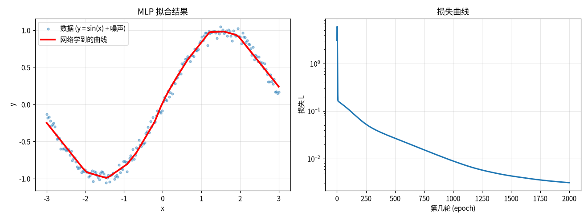

*Figure 1: NumPy MLP fitting sin(x). Left: the fit. Right: the loss curve.*

After this, backprop stopped being a black box, and moving to PyTorch was much easier.

## 4. Project Zero: California Housing

The data is California Housing: 20,640 block groups, 8 features, target is the median house value in units of $100k. I standardized with training-set mean and standard deviation only, to avoid leakage. The split was 80/20.

Test results: **R² = 0.6374, RMSE = 0.7048** (about $70k).

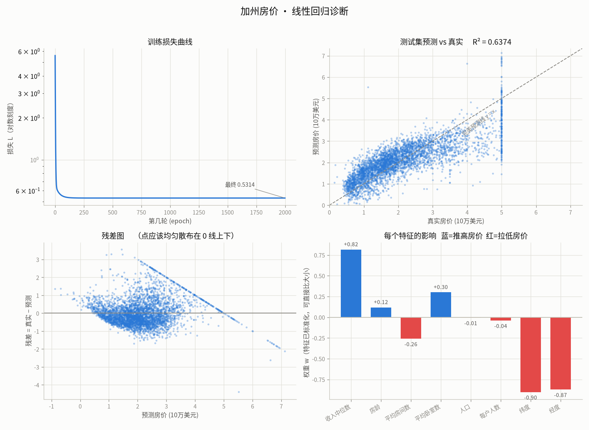

*Figure 2: California Housing linear regression diagnostics. Top right: predicted vs. true on the test set, R² = 0.6374. Bottom right: standardized feature weights.*

Two things stand out. First, the residuals are heteroscedastic: errors grow with price. Second, there is a vertical line at a true value of 5.0. The dataset caps the target at 5.00001; that line is an artifact, not a model failure.

The feature weights are also readable: median income has a positive weight (+0.82); latitude and longitude are negative (−0.90 and −0.87), which matches the fact that coastal California is more expensive.

The point of this project was not to push R². It was to get the whole pipeline right: splitting, standardizing with training statistics only, and reusing the same mean/std for new samples. The later projects reuse this setup.

## 5. Fashion-MNIST

### 5.1 MLP

The first version was an MLP:

```
Flatten -> Linear(784, 256) -> ReLU -> Linear(256, 10)
```

203,530 parameters, 20 epochs, Adam, lr = 1e-3, weight decay = 1e-4. Test accuracy 86.88%.

That is not bad, but it is about 5 points below the final CNN (92.25%). The MLP flattens the 28×28 image and throws away the 2D structure, so neighboring pixels are never used together.

### 5.2 CNN

The basic CNN was:

```
Conv(1->16, 3x3, padding=1) -> BatchNorm(16) -> ReLU -> MaxPool(2)
Conv(16->32, 3x3, padding=1) -> BatchNorm(32) -> ReLU -> MaxPool(2)
Flatten -> Dropout(0.5) -> Linear(1568, 10)
```

10 epochs, Adam, lr = 1e-3, batch 64, no augmentation. Test accuracy 90.24% (roughly 90.2–90.7% across seeds). That is about 3.4 points above the MLP.

Then I scaled it up: three convolutions (32 / 64 / 128 channels), BatchNorm after each, Dropout(0.5) before the classifier, RandomHorizontalFlip and RandomCrop(28, padding=4) during training, Adam with CosineAnnealingLR, 30 epochs. Test accuracy reached 92.25%.

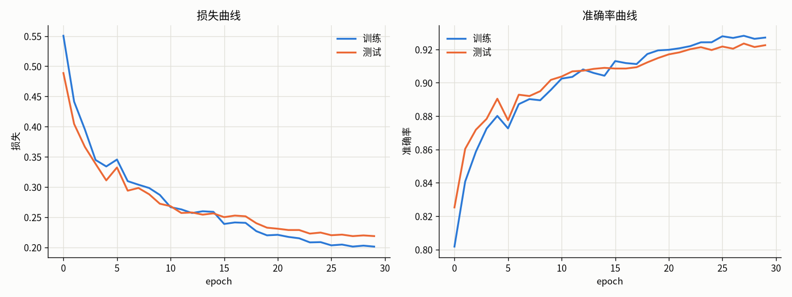

*Figure 3: Training curves of the improved CNN over 30 epochs. Final test accuracy 92.25%; train and test curves stay close.*

92.25% is not high for Fashion-MNIST. The point of this version was to run through the standard tricks and see what each one is for.

The confusion matrix is more informative:

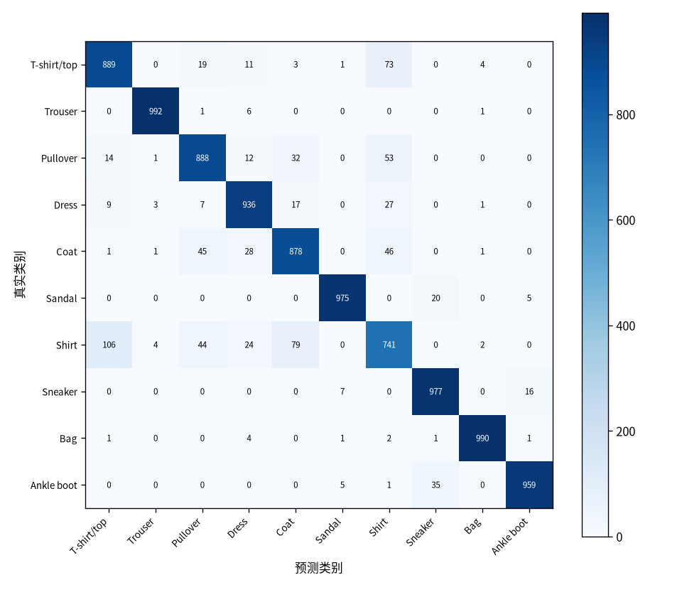

*Figure 4: Confusion matrix on the test set.*

Per-class accuracy:

| Class | Accuracy | Class | Accuracy |
|---|---|---|---|
| Trouser | 99.2% | Bag | 99.0% |
| Sneaker | 97.7% | Sandal | 97.5% |
| Ankle boot | 95.9% | Dress | 93.6% |
| T-shirt/top | 88.9% | Pullover | 88.8% |
| Coat | 87.8% | Shirt | 74.1% |

Shirt is the worst. It is easily confused with other upper-body garments, especially at 28×28 grayscale. Trouser, Bag, and Sandal, whose silhouettes are very different, are all above 97%.

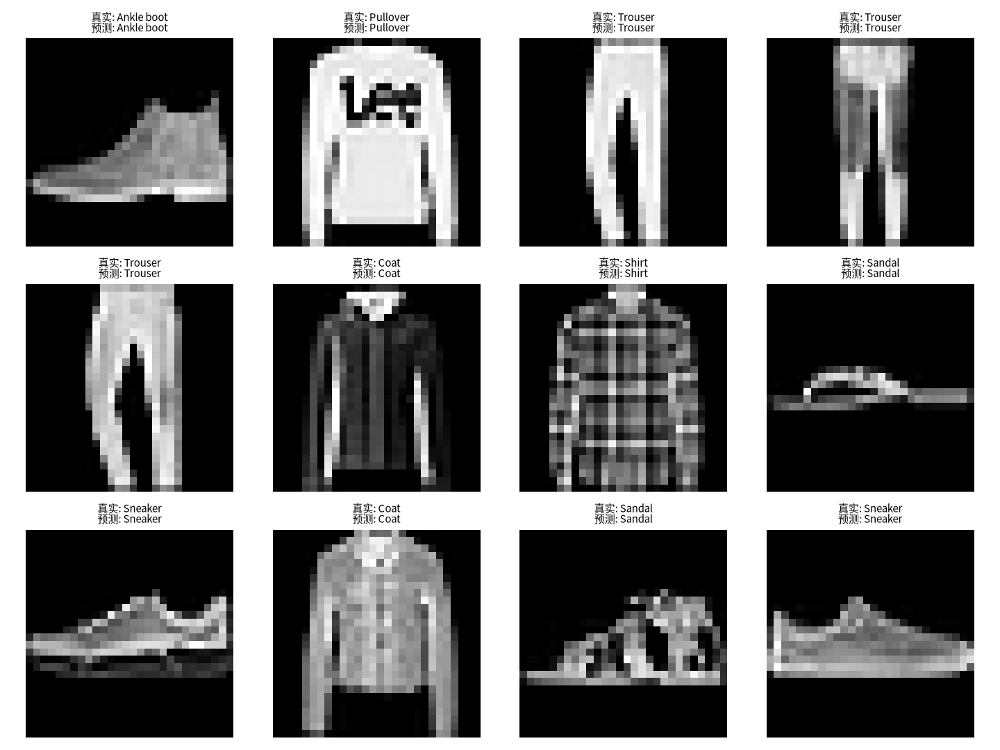

*Figure 5: Correctly classified samples.*

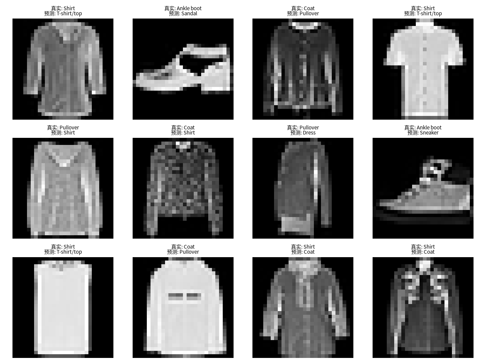

*Figure 6: Misclassified samples. The errors are concentrated among upper-body garments and shoes.*

I also plotted the first 16 of the 32 first-layer 3×3 filters:

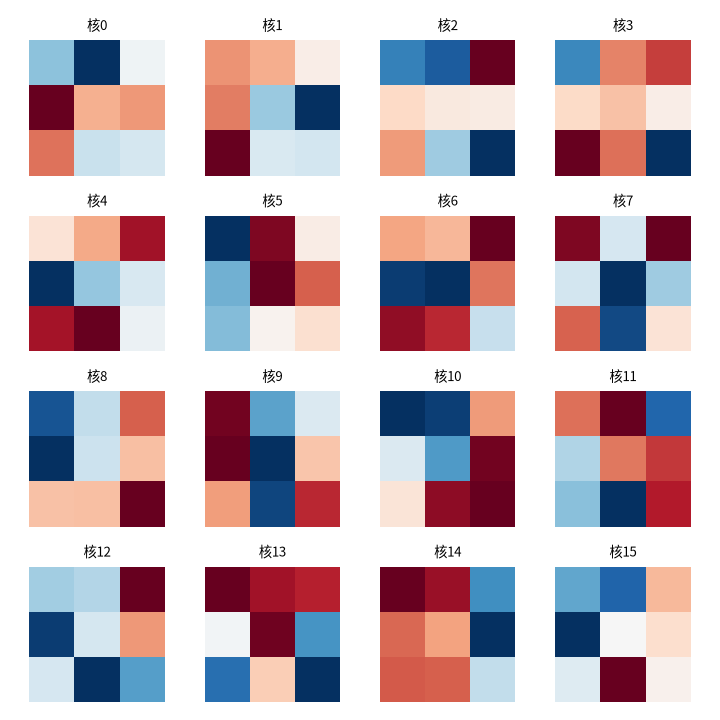

*Figure 7: The first 16 of the 32 first-layer 3×3 filters.*

You can see some edge and brightness responses, but nothing very interpretable. A 3×3 filter has very little capacity; the semantic features are in the later layers.

## 6. Sequences and Attention

### 6.1 Vanishing Gradients

I ran a controlled experiment: a single-layer RNN / GRU / LSTM, sequence length from 10 to 200, measure the norm of the gradient of the final loss with respect to the initial hidden state `h0`, and plot it on a log scale.

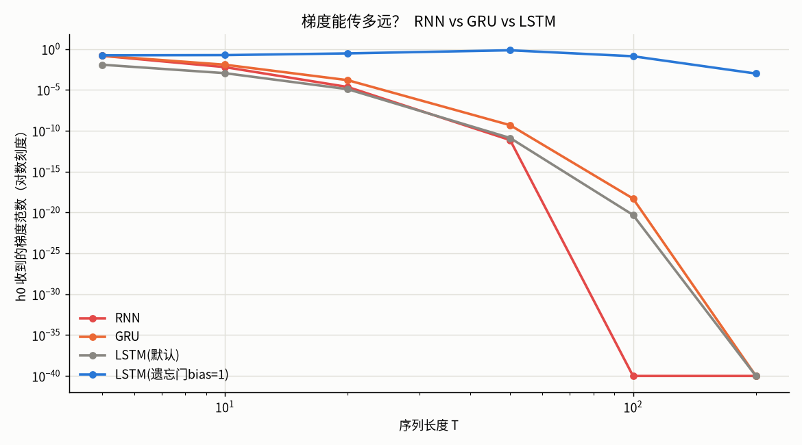

*Figure 8: Gradient norm versus sequence length for different recurrent cells (log scale).*

The results:

- For the RNN, at T = 100 the gradient is already around 1e-40, effectively zero.
- GRU and the default LSTM decay more slowly, but at T = 100 they are also around 1e-18 to 1e-20.
- With the LSTM forget-gate bias initialized to 1, the gradient is still around 1e-1 at T = 100 and about 1e-3 at T = 200. So the LSTM does mitigate the problem.

The reason: LSTM's cell state has an additive path. When the forget gate is close to 1, the gradient can travel a long way. With default initialization the forget gate is around 0.5, so the signal decays quickly.

### 6.2 Attention from Scratch

I implemented scaled dot-product attention from scratch and checked it against `F.scaled_dot_product_attention`. The maximum error was about 1.8e-7.

An attention matrix is read as follows: each row is a query position, each column is a key position, and the entry is how much information that query takes from that key. Each row sums to 1.

## 7. Transformer

### 7.1 Mini-GPT on 400 Characters

The first Mini-GPT used the 400-character Alice text from lesson11. Configuration: D = 128, 4 heads, 3 layers, 605,352 parameters. 2000 steps; loss went from 4.0 to 0.05.

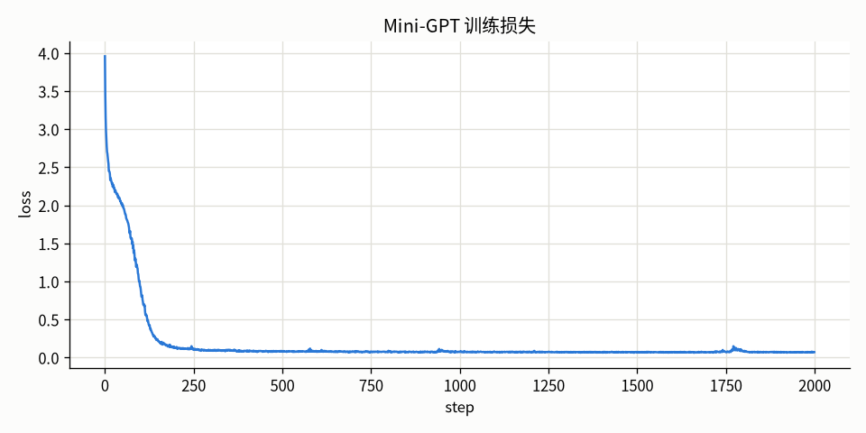

*Figure 9: Mini-GPT loss on the 400-character corpus.*

This version got all the Transformer pieces working: embedding + positional encoding, Pre-LN residual blocks, FFN, causal mask, training loop, autoregressive generation. But 400 characters is tiny. A loss of 0.05 basically means it memorized the text; longer generations start copying fragments.

### 7.2 Encoder-Decoder and Cross-Attention

The stage-3 checkpoint task was sequence reversal:

```
input:  [3, 7, 1, 9, 2]
output: [2, 9, 1, 7, 3]
```

The structure is a standard encoder-decoder. The encoder uses bidirectional self-attention with no mask. The decoder does causal self-attention, then cross-attention, then an FFN. Training uses teacher forcing: the decoder input is the target shifted right, with a BOS token in front.

The task itself can be done with one `torch.flip`, so using a network is overkill. The value is that it tests the seq2seq machinery: whether the encoder can encode the whole input and whether the decoder can find the right position through cross-attention.

Results: 16 fixed samples overfit to 100%; 256 unseen sequences were all correct at the whole-sequence level, also 100%.

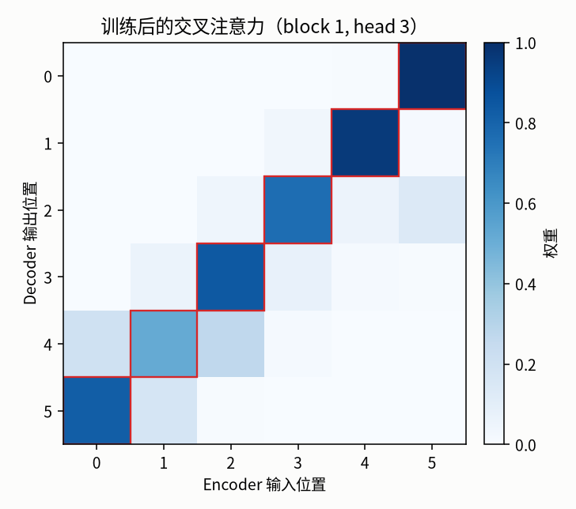

*Figure 10: One cross-attention head after training. The red boxes mark the ideal reverse alignment; the learned weights fall almost exactly on them.*

The argmax of this head is `[5, 4, 3, 2, 1, 0]`, exactly the reverse alignment. Nothing in the code says "reverse"; it learned this from data.

This section also produced the most bugs: three kinds of masks, Q versus K/V lengths, and the teacher-forcing shift. The details are in `notes/debugging_notes.md`.

### 7.3 A Real Corpus: tiny Shakespeare

With 7.1 and 7.2 working, I switched the corpus to tiny Shakespeare (1,115,394 characters, vocabulary 65).

Configuration:

| Item | Value |
|---|---|
| Parameters | 4,772,417 |
| D | 256 |
| Layers | 6 |
| Heads | 8 |
| block_size | 128 |
| Training steps | 6000 |
| Optimizer | AdamW, lr 3e-4, warmup 200, cosine |
| Device | RTX 3060 Laptop, about 9 minutes |

Results:

```
train loss  1.0399
val loss    1.6359
perplexity  5.13
```

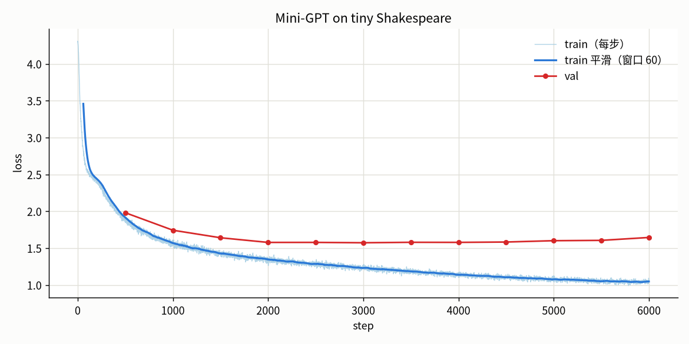

*Figure 11: Train and validation loss on tiny Shakespeare. Validation loss is lowest around step 2000–2500 (about 1.56), then creeps back up.*

The curve shows mild overfitting: train loss keeps falling, but validation loss stops improving after about 2000 steps and ends at 1.64. The reason is simple: 1.1M characters is small for 4.77M parameters.

Samples (same prompt `ROMEO:`, top-k = 40):

```
temperature = 0.5
ROMEO:
I was born an appointed he hath been deliver'd.

Nurse:
What, what a sair, back and power to be list,
Which we shall become then there was like a life
...

temperature = 1.0
ROMEO:
I do that demand this friar slander; and, saw my weapon:
Look some betides, that preys greatness on him.

CAPULET:
That 'forgive, I hope, sovereign, be breast!
...
```

Lower temperature gives more fluent but more repetitive text; higher temperature gives more variety but more invented words and grammar errors. This matches the softmax shape: low temperature makes the distribution sharp, favoring frequent, safe character combinations; high temperature flattens it, increasing diversity and the chance of errors.

The limitations are obvious: character-level, 4.77M parameters, no instruction tuning. It can continue Shakespeare-style English; it cannot hold a conversation.

## 8. Limitations

There are four main ones:

1. The models are small. The largest is the 4.77M-parameter character-level Mini-GPT, still far from a usable language model.
2. No ablation for the CNN. 90.24% → 92.25% is the overall gain; I did not measure BatchNorm, Dropout, and data augmentation separately.
3. No out-of-distribution test. Fashion-MNIST test and train come from the same distribution; real clothing photos would be much worse.
4. Sequence reversal is too simple. It verifies the mechanism, not reasoning ability.

## Appendix

### Repository Structure

```
DeepLearning/
├── 00_python_numpy/     NumPy, linear regression, gradient checks
├── 01_mlp/              NumPy MLP from scratch
├── 02_fashion_mnist/    MLP / CNN / visualization
├── 03_housing/          California Housing end-to-end project
├── 03_rnn_attention/    RNN / LSTM / vanishing gradients / attention
├── 04_transformer/      Transformer / Mini-GPT / encoder-decoder
├── demo/                interactive demos
├── notes/               debugging notes
└── ROADMAP.md           learning plan and progress
```

